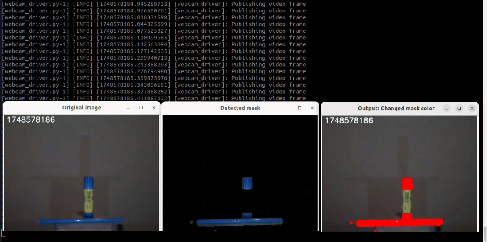

# ROS 2 Webcam Driver & Color Filter

The project captures live webcam images,  identifies the color - Blue, and changes it to Red. It demonstrates communication between Python and C++ ROS 2 nodes through image topics, with a launch file to bring up the packages.

## Overview

The pipeline consists of two main nodes:

- Webcam Driver (Python): Captures images from a webcam using OpenCV and publishes them as ROS 2 image messages.

- Color Filter (C++): Subscribes to the webcam image stream, identifies colour and replaces it before publishing the processed image.

The nodes communicate through ROS 2 publisher-subscriber interfaces. A launch file starts both nodes and allows selected parameters to be configured.

## Requirements

- ROS 2
- colcon
- OpenCV
- cv_bridge
- ROS 2 image message packages (sensor_msgs)

## Packages

### `apple`

ROS 2 Python node that captures video from the webcam and publishes it as a `sensor_msgs/msg/Image`.

### `blue`

ROS 2 C++ node that subscribes to webcam image, replaces a specified color and publishes the resulting image.

### `color_detection`

ROS2 bring-up package to launch both webcam driver and color filter packages.

## Usage

1. **Build the workspace**

```bash
cd color_detection_ws
colcon build --symlink-install
source install/setup.bash

```

2. **Launch both nodes**

```bash
ros2 launch color_detection color_detection.launch.py

```

## Result


